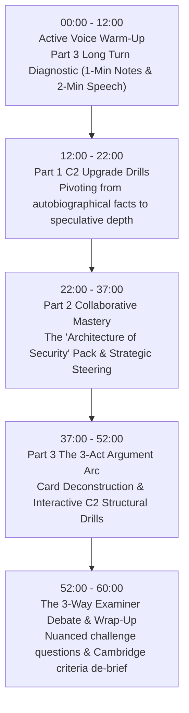

# Lesson Plan: Cambridge C2 Proficiency (CPE) Speaking Mastery
**Student:** Gaia · Cambridge C2 Proficiency (CPE)  
**Theme:** Deconstructing Authentic C2 Speaking Prompts, Collaborative Negotiation & The 2-Minute Long Turn  
**Target Level:** Cambridge English: Proficiency (CEFR C2)  
**Estimated Duration:** 60 minutes  
**Pedagogical Framework:** Active Voice First · Task-Based Cambridge Speaking Mechanics · C2 Structural Precision  

---

## 🎯 Lesson Overview & Core Objectives

* **Core Focus:** Conquering the 3 stages of the Cambridge C2 Speaking Exam using authentic, candidate-reported prompts (Digital Solitude, Algorithmic Curation, Societal Security, and the 2-Minute Monologue).
* **Active Speaking Warm-Up:** Immediate immersion in the Part 3 Long Turn (Microphone to Gaia in Minute 01).
* **Target C2 Structural Devices:**
  * *Negative & Limiting Inversions* (`At no juncture did...`, `Not only does... but...`)
  * *Split & Pseudo-Cleft Sentences* (`What underscores this shift is...`, `It is precisely this... that...`)
  * *Evaluative Passive Reporting* (`...is widely purported to...`, `...are held to be...`)
  * *Participial Modifiers* (`..., thereby precipitating...`, `Having established that...`)
* **Communicative Outcome:** Master Gareth's *3-Act Argument Arc* for the 2-minute long turn, execute collaborative steering in Part 2, and seamlessly upgrade B2/C1 stock phrases into effortless C2 discourse.

---

## ⏱️ Step-by-Step Lesson Flow (60 Mins)



---

## Stage 1: Active Voice Warm-Up (Minutes 00:00 – 12:00)
*No passive lecturing. Gaia takes the microphone within the first 120 seconds.*

### Slide 1: Part 3 Authentic Cue Card (Live Diagnostic)
**Task Card:**
> ### The Value of Deep Reading in an Algorithmic Age
> **Why do modern societies appear to be reading fewer long-form books?**
> * Cognitive attention spans
> * Alternative entertainment streams
> * Cultural perceptions of 'time poverty'

#### Practical Structuring Rules
1. **The 1-Minute Note Secret:** Jot down strictly **4 single trigger keywords** down the margin—one central thesis plus one word per bullet. Never write full sentences.
2. **The Cambridge Anchor:** The printed bullet points are springboards, not an interrogation checklist. Select the two most compelling angles and explore their friction.
3. **The 3-Act Story Arc (120 Seconds):**
   * *Act I: The Thesis & Context (30s)* — Frame the cultural paradox.
   * *Act II: Core Friction & Nuance (60s)* — Contrast superficial browsing with cognitive stamina.
   * *Act III: The 'So What?' Reflection (30s)* — Address long-term societal consequences.

---

### Slide 2: Immediate Partner Evaluation Drill
*Imagine your partner has just concluded their 2-minute turn on reading habits. Avoid the novice trap of simply saying "I agree completely."*

**The Evaluative Formula:**
$$\text{Acknowledge Core Point} + \text{Introduce Unexamined Tension} + \text{Speculative Extension}$$

**Drill Prompt:**
> *"Candidate B, to what extent do you agree that digital media has permanently degraded our capacity for contemplative thought?"*

<details>
<summary>👁️ Reveal Cambridge C2 Model Response</summary>

> *"While my partner rightly highlighted how algorithmic feeds fragment daily attention, I would argue the issue is less about cognitive degradation and more about functional adaptation. What we are witnessing is not necessarily the death of literacy, but rather a wholesale migration toward non-linear processing. Whether this trade-off ultimately erodes our capacity for deep empathy remains the critical question."*
</details>

---

## Stage 2: Part 1 — The C2 Evaluative Shift (Minutes 12:00 – 22:00)
*Moving away from standard conversational answers into sophisticated speculative discourse.*

### Slide 3: Beyond the Autobiographical (The Formula)

In Part 1, Cambridge examiners deliberately ask seemingly straightforward lifestyle and background questions to see whether you remain at a B2 conversational plateau or elevate the topic into mature reflection.

$$\text{Personal Point of Departure} \longrightarrow \text{Societal / Macro Parallel} \longrightarrow \text{Evaluative Synthesis}$$

| B2/C1 Conversational Plateau | C2 Evaluative Precision |
| :--- | :--- |
| *"I try to go to the gym three times a week because it helps my stress levels."* | *"Given the sedentary nature of modern professional life, carving out time for physical exertion is less a recreational luxury and more an indispensable counterweight to cognitive burnout."* |
| *"I think young people waste too much time on TikTok and gaming."* | *"It is easy to dismiss contemporary adolescent leisure as frivolous distraction, yet one could equally argue it represents an alternative form of communal socialization in an increasingly privatized world."* |

---

### Slide 4: Interactive Part 1 Rapid-Fire Workout
*Select one prompt and formulate an immediate 45-second response applying an Introductory 'It' or Cleft structure:*

1. **On Heritage & Culture:** *"If a foreign visitor had only twenty-four hours in your home country, what single encounter would give them the truest impression of your culture?"*
2. **On Career Horizons:** *"Looking ahead over the next decade, how do you foresee the balance between human craftsmanship and automation shifting in your field?"*
3. **On Language Acquisition:** *"Looking back at your language journey, what has been the single most counterproductive myth you had to unlearn?"*

<details>
<summary>👁️ Reveal Model Structural Blueprint</summary>

* **Cleft Sentence Blueprint:**  
  `What strikes me as + [Noun/Clause] + is not so much X, but rather Y.`
* **Introductory 'It' Blueprint:**  
  `It is tempting to suggest that..., yet on closer inspection, one realizes that...`
</details>

---

## Stage 3: Part 2 — Collaborative Synergy & Strategic Steering (Minutes 22:00 – 37:00)

### Slide 5: The "Architecture of Security" Pack
*Visual Stimuli: Four contrasting scenes displayed on screen:*
* **Image A:** Biometric facial recognition turnstiles at an international airport terminal.
* **Image B:** An elderly residential neighborhood with a visible "Neighbourhood Watch" street sign.
* **Image C:** A software engineer monitoring real-time cybersecurity server intrusion graphs.
* **Image D:** A suburban smart-home doorbell camera streaming a live feed to a mobile phone.

---

### Slide 6: Phase 1 — Rapid Comparative Evaluation (1 Minute)
**Task:**
> *"Look at pictures A and D. Talk together about what distinct dimensions of surveillance and modern vulnerability these images illustrate."*

**Interactive Phrase Toolkit:**
* *"What immediately stands out in picture A is the institutionalisation of surveillance, whereas..."*
* *"There is an intriguing paradox between state-mandated security and the voluntary domestic surveillance captured in..."*
* *"Would you say both images tap into an underlying collective paranoia, or is it purely pragmatic?"*

---

### Slide 7: Phase 2 — The Consensus Challenge (3 Minutes)
**Task:**
> *"Now look at all four pictures. Imagine a publisher is releasing a critical essay collection titled:  
> **'The Fortress Mindset: Freedom and Paranoia in the Modern Era'.**  
> Talk together about how each scene reflects our shifting attitudes towards safety. Then, decide which **two images** should feature on the jacket cover and justify which one must be rejected."*

```
                    ┌─────────────────────────┐
                    │  1. OPEN THE DIALOGUE   │
                    │ "Shall we first tackle  │
                    │  the institutional vs.  │
                    │  domestic contrast?"    │
                    └────────────┬────────────┘
                                 │
                    ┌────────────▼────────────┐
                    │  2. TEST FRICTION       │
                    │ "While Image A is striking,│
                    │  doesn't Image D speak  │
                    │  more to everyday life?"│
                    └────────────┬────────────┘
                                 │
                    ┌────────────▼────────────┐
                    │  3. STEER TO CONSENSUS  │
                    │ "Given our criteria of   │
                    │  'paranoia', we seem to │
                    │  be aligned on A and D."│
                    └─────────────────────────┘
```

<details>
<summary>👁️ Reveal Cambridge Model Steering Expressions</summary>

* **Inviting Partner Engagement:**  
  *"You seem somewhat ambivalent about Image B—do you feel it lacks the thematic punch of the digital threats?"*
* **Reframing Disagreement Gracefully:**  
  *"I concede that Image C depicts high-stakes corporate espionage; nonetheless, for a general readership, wouldn't the domestic intimacy of Image D strike a far more chilling chord?"*
* **Guiding Toward Decision Under Time Limits:**  
  *"We have barely forty seconds remaining, so perhaps we should narrow our verdict down to the final pairing..."*
</details>

---

## Stage 4: Part 3 — Deconstructing the 2-Minute Monologue (Minutes 37:00 – 52:00)

### Slide 8: The C2 Cue Card Masterclass
*You have 10 seconds to read the card. You do not get 1 minute of silence like in IELTS; at C2, you are expected to synthesize immediately.*

> ### Enterprise & Autonomy in Modern Work
> **Is self-employment fundamentally superior to traditional corporate employment?**
> * Financial stability vs. volatile reward
> * Intellectual autonomy and ownership
> * The psychological toll of perpetual risk

---

### Slide 9: High-Scoring C2 Structural Blueprint Workout
*Transform everyday arguments into authentic C2 syntactic devices:*

#### 1. Negative Inversion
* **Everyday Sentence:** *"People rarely understand how stressful freelancing really is."*
* **Formula:** `Seldom / Rarely / At no point + Auxiliary + Subject + Main Verb`
* **Workout:** Transform using `SELDOM`.

#### 2. Participial Clause
* **Everyday Sentence:** *"Corporate workers surrender their creative autonomy and as a result they suffer from quiet dissatisfaction."*
* **Formula:** `Surrendering X, [Subject] + Verb, thereby + [Verb-ing]`
* **Workout:** Transform into a single fluid sentence.

#### 3. Passive Reporting Construction
* **Everyday Sentence:** *"Most economists believe that gig-economy platforms exploit vulnerable contractors."*
* **Formula:** `Subject + BE + [alleged / believed / contended] + to + [Infinitive]`
* **Workout:** Transform starting with *"Gig-economy platforms..."*

<details>
<summary>👁️ Reveal Cambridge Upgrades</summary>

1. **Inversion:**  
   *"Seldom do aspiring entrepreneurs appreciate the acute psychological toll that perpetual income volatility incurs."*
2. **Participle:**  
   *"Having surrendered their intellectual autonomy to corporate hierarchies, employees frequently endure an insidious sense of alienation, thereby stifling their creative initiative."*
3. **Passive Reporting:**  
   *"Gig-economy platforms are widely contended to exploit independent contractors under the seductive guise of personal autonomy."*
</details>

---

## Stage 5: The Three-Way Examiner Discussion (Minutes 52:00 – 60:00)
*The final 6–8 minutes where the interlocutor pushes both candidates to defend, qualify, and complicate abstract ideas.*

### Slide 10: Nuance, Concession & Philosophical Extension
*Discuss these Cambridge C2 follow-up challenges:*

1. **On Technological Inevitability:**  
   *"Is the instinct to preserve traditional cultural rituals simply an exercise in sentimental nostalgia, or does it serve a vital social function?"*
2. **On Ethical Boundaries:**  
   *"To what extent should scientific inquiry be constrained when its applications pose theoretical risks to social cohesion?"*
3. **On Perfectionism:**  
   *"In high-performance academic or corporate fields, is the relentless pursuit of perfectionism a prerequisite for excellence, or a destructive pathology?"*

---

### Slide 11: The Cambridge C2 Assessment Checklist

| Criterion | What the Examiners Are Listening For | What Loses Marks |
| :--- | :--- | :--- |
| **Grammatical Resource** | Natural command of complex syntactic frames (clefts, inversions, fronted adverbials, conditional nuances). | Relying solely on coordinate sentences (*and*, *but*, *so*) or forced, unnatural bookish grammar. |
| **Lexical Resource** | Precise, idiomatic collocation and register control (*insidious alienation, acute volatility, unexamined premise*). | Memorised, decorative thesaurus words dumped out of context (*plethora, conundrum, ubiquitous*). |
| **Discourse Management** | Sustained coherence across 2 full minutes; purposeful rhetorical pacing; graceful transitions. | Halting before 90 seconds, repetitive looping, or treating prompts like an itemised checklist. |
| **Interactive Communication** | Sensitive conversational negotiation; building on partner contributions; collaborative time management. | Monologuing during Part 2, ignoring partner cues, or aggressive interruption. |
| **Pronunciation & Intonation** | Expressive intonation signaling contrast, irony, qualification, and syntactic weight. | Flat, robotic delivery devoid of pitch movement. |

---

## 📝 Diagnostic Follow-Up Task
> *"Choose one of the Part 3 Long Turn cards explored today. Record an unedited, 2-minute voice memo under strict exam conditions (no rehearsal, 10 seconds to glance at the prompt). Send the audio to me prior to our next session for a granular C2 lexical and discourse audit."*
